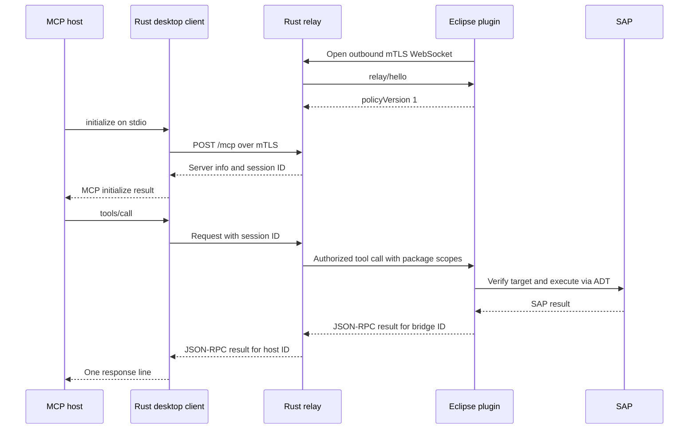

# Developer Guide

The relay routes each desktop MCP session to its selected, authorized Eclipse workspace. Rust owns transport authentication, endpoint grants, session routing, and desktop policy. The plugin owns tool schemas, SAP credentials, tool execution, and verification of a target object's SAP package.



## Source Map

| Entry point | Responsibility |
| --- | --- |
| [Server main](../src/main.rs) and [TLS transport](../src/transport.rs) | CLI modes, listener setup, peer certificate extraction, request authentication and limits |
| [MCP endpoint](../src/mcp.rs) and [bridge](../src/bridge.rs) | MCP lifecycle, tool authorization, socket ownership, deadlines, and request correlation |
| [Policy store](../src/policy.rs) | Known-action catalog, rule validation, global and desktop intersection, durable edits |
| [PKI](../src/security.rs) and [enrollment](../src/enrollment.rs) | Issuance, role pins, revocation, request selection, and one-time claims |
| [TUI](../src/tui.rs), [rule editor](../src/tui/rules.rs), and [logs](../src/logs.rs) | Local operator actions, terminal lifecycle, bounded diagnostic history |
| [Desktop client](../src/bin/sap-adt-mcp-client.rs) and [client modules](../src/bin/client) | Profile enrollment, bootstrap verifier, pinned TLS, stdio framing and session headers |
| [Java server package](../java-plugin/sap-adt-mcp-server/com.sap.adt.mcp.server.plugin/src/com/sap/adt/mcp/server) | Relay identity, encrypted workspace profile, outbound WebSocket, JSON-RPC validation, and scoped execution |
| [Java SAP tools](../java-plugin/sap-adt-mcp-server/com.sap.adt.mcp.server.plugin/src/com/sap/adt/mcp/tools) and [SAP transport](../java-plugin/sap-adt-mcp-server/com.sap.adt.mcp.server.plugin/src/com/sap/adt/mcp/sap) | ADT requests, tool schemas, object addressing, package metadata parsing, and SAP session state |
| [Java UI](../java-plugin/sap-adt-mcp-server/com.sap.adt.mcp.server.plugin/src/com/sap/adt/mcp/ui) and [Tycho build](../java-plugin/sap-adt-mcp-server/pom.xml) | Registration and connection UI, plugin lifecycle, feature and p2 site assembly |

## Enrollment and Trust

1. `init` generates a dedicated CA and server identity in a new private directory. Both TLS listeners use the server leaf and CA chain. The enrollment listener permits initial connections without a client certificate. The data listener requires TLS 1.3 client authentication.
2. A requester generates a random ID and posts `{"id":"<32 lowercase hex>","role":"desktop","label":"Anna desktop"}` to `/request`. Eclipse uses role `eclipse`. Initial contact is bootstrap traffic. Its fields carry no SAP credentials, bearer token, or private key. The operator sees the request ID, role, label, and TCP peer. A request waits up to 180 seconds for a decision.
3. Approval rechecks the selected pending request and grants a fresh CSPRNG secret. The initial response carries only `id` and `ca_pem`. The local TUI dialog or headless approval terminal displays the secret and CA commitment in GW1 format. The 64-byte payload is 32 secret bytes followed by SHA-256 of the CA DER, encoded as 103 Crockford Base32 symbols. Groups of five are joined by hyphens after the `GW1-` prefix. The server retains the secret hash with the role, label, and independent 180-second claim deadline.
4. The requester receives the token through the trusted operator channel, checks its CA commitment against the bootstrap CA, and creates a fresh TLS connection with that CA and hostname verification. Only this connection sends `POST /claim` with `{"token":"<GW1 token>"}`. The server compares the hash and CA pin in constant time, consumes the grant once, and returns `ca_pem`, `client_cert_pem`, and `client_key_pem`. A failed or lost claim may require a new request.
5. The signed client common name carries the role prefix. The server records SHA-256 of the issued leaf DER under that role. The PKI checks both signed role and current fingerprint membership. The desktop saves its profile under OS account permissions. Eclipse saves an AES-GCM-encrypted workspace profile with a wrapping key in Eclipse secure preferences.

The enrollment registry is memory-only and bounded to 16 pending requests and grants together. Closing registration invalidates outstanding entries. Restarting drops the registry. Plain `--headless` leaves the enrollment port unbound. With `--headless --issue-token`, startup acquires an attached operator terminal, enables enrollment, and starts the enrollment listener. The console assigns a unique local number to each displayed request. Approval or denial selects that number and rechecks the pending request, so reusing a client-supplied ID cannot apply a stale decision to its replacement. Both operator interfaces use the same approval and claim lifecycle.

Headless approval reads and writes through `/dev/tty` on Unix or the Windows console devices. Keep these handles separate from the diagnostic writer. A redirected stdin, stdout, or stderr must never become the approval channel, and failure to acquire the terminal must prevent startup.

## Data Protocol

| Endpoint | Contract |
| --- | --- |
| `GET /endpoints` | Requires an enrolled desktop certificate. Returns `{"endpoints":[{"id":"…","label":"…","online":true}]}` with enrolled Eclipse identities granted to this desktop. Works before selection and includes offline workspaces |
| `POST /mcp` | One JSON-RPC object in an `application/json` body. Supports `initialize`, `ping`, `tools/list`, and `tools/call`. Valid notifications return HTTP 202 without a tool response |
| `DELETE /mcp` | Releases the session identified by the session header after checking the desktop certificate and protocol version |
| `GET /bridge` | WebSocket upgrade with an authorized Eclipse certificate. One UTF-8 JSON-RPC object per text message |

The desktop helper sends the selected Eclipse certificate's lowercase SHA-256 fingerprint in the `X-Sap-Adt-Endpoint` header. Initialization checks the grant and live bridge, then binds the session to that desktop identity and connection. The helper retains the negotiated `MCP-Protocol-Version` and `Mcp-Session-Id`. Every subsequent request checks session ownership and endpoint access. The relay answers `relay_list_endpoints` locally, returning the selected ID and the caller's authorized catalog. The host sees newline-delimited JSON-RPC on stdio. Diagnostics go to stderr. A browser-provided `Origin` is refused.

Rust sends `relay/hello` on a new bridge and requires an object containing numeric `policyVersion: 1` before allowing a session to initialize. Rust then sends `ping`, `tools/list`, and `tools/call` using its own positive integer IDs. Eclipse replies with the same bridge ID and exactly one result or error. The relay preserves the desktop's original MCP request ID independently. A malformed reply, mismatched ID, unexpected message, or timeout closes that bridge.

Rust constructs the call sent to Eclipse from the authorized tool name, original tool arguments, and effective package constraints. The following is an internal bridge message.

```json
{
  "jsonrpc": "2.0",
  "id": 7,
  "method": "tools/call",
  "params": {
    "name": "sap_search_object",
    "arguments": {"query": "ZFIN*", "max": 10},
    "relayPackageScopes": [["ZFIN*", "/ACME/*"], ["/ACME/FIN*"]]
  }
}
```

An outer empty array represents unrestricted packages. Each inner list is a disjunction. A verified target must satisfy every inner list. An empty inner list permits no target. Client-supplied policy fields have no authority. Eclipse validates the envelope, tool arguments, and scope patterns before dispatch.

## Authorization

The PKI directory contains `policy.json` and a persistent `policy.lock`. The `endpoint_grants` map associates a desktop certificate fingerprint with its permitted Eclipse fingerprints. An absent map, absent entry, or empty grant list permits no workspace access. Re-enrollment creates a new identity. A label is display data. Independently, global and desktop rules each contain `read_only`, `actions`, and `packages`. A JSON `null` action or package list is unrestricted, while an empty array permits none. A missing desktop rule override means read-only with unrestricted lists. Global rules default to all recognized SAP actions.

Discovery filters Eclipse's schemas using effective access. Direct invocation independently loads effective rules before dispatch. A malformed, missing, oversized, or ambiguous policy fails closed. Saving stages a private file, checks the revision under an exclusive lock, and atomically replaces the document. Operator edits use a revision derived from the bytes the editor opened. Keep the lock file with policy backups so deletion of an initialized document is detected.

| Classification | Tools |
| --- | --- |
| Read-only, support package constraints | `sap_search_object`, `sap_get_source`, `sap_object_structure` |
| Read-only, require unrestricted packages | `sap_inactive_objects`, `sap_usage_references`, `sap_abap_docu` |
| Require write-enabled rules, support package constraints | `sap_create_object`, `sap_lock`, `sap_unlock`, `sap_set_source`, `sap_activate` |
| Require write-enabled rules and unrestricted packages | `sap_sql_query`, `sap_syntax_check`, `sap_run_unit_test`, `sap_atc_run` |

A source write also requires permission for lock, unlock, and activate in both rule layers. Classify new tool names explicitly. The relay rejects unknown tools even under unrestricted action lists.

Package patterns are canonicalized to uppercase. Exact names and a single trailing wildcard are supported, including `$TMP`, `ZFI*`, and `/ACME/*`. Each layer supports up to 64 patterns and the literal portion of a pattern is at most 30 characters. In the operator package editor, entering a lone `*` saves unrestricted access. In the wire format, a pattern `"*"` inside a layer still requires a verified package.

In the plugin, scoped search filters hits by verified ownership. For existing objects, scoped calls resolve supported object type and name and verify the corresponding SAP metadata. Missing metadata or conflicting identity fails closed. Structure reads use the verified metadata response. Source reads recheck ownership after retrieval, and source writes verify again while acquiring the lock. Scoped unlock requires the handle recorded for that target in the active SAP session. Creation checks the destination package written into the create request. A scoped policy constrains operation targets. It does not inspect the semantics of ABAP source code.

## Concurrency and Failure Handling

* Each Eclipse certificate can reserve one active bridge. The relay accepts up to 128 pending or active bridges from distinct Eclipse certificates. Sessions and the request channel belong to the exact bridge connection. Disconnecting it invalidates its own sessions. A replacement connection requires fresh initialization.
* Each session also belongs to the desktop certificate that initialized it. Reusing another desktop's session ID fails. Each endpoint allows 128 sessions and expires idle sessions after eight hours. Desktop revocation takes effect at the HTTP boundary. The relay rechecks the Eclipse pin before dispatch and on idle heartbeats.
* Each Eclipse SAP client is stateful, including locks. Each bridge admits one call at a time. Overlapping calls on that bridge receive a busy error. Calls on different bridges are independent. Idle heartbeat interval and deadline are 20 seconds. Bridge calls have a ten-minute deadline. A disconnected or timed-out mutation has an uncertain SAP outcome. Preserve that error to the host and avoid automatic replay.
* The data listener accepts at most 128 concurrent TLS/HTTP connection slots and enrollment uses a separate budget of 32. Both constrain TLS handshake and header read time. The desktop request and Java incoming request limits are 4 MiB. The bridge accepts a response up to 8 MiB. The stdio client bounds concurrency and response size.
* Logging can include the authorized tool name, desktop fingerprint, and connection or policy events. Exclude request bodies, SAP results, token strings, and private keys. Interactive logs are bounded in memory. Headless logging uses stderr. TUI token copy uses an explicit OSC 52 clipboard request.

## Extending a Tool

1. Add or update the Java tool implementation and its `McpTool` schema. Verify existing and new argument combinations, SAP URL construction, SAP session requirements, and failure results. Register it in the Eclipse tool list used by the relay.
2. Classify the action in the Rust catalog. Determine whether it writes data, takes a lock, starts a run, or invokes other actions internally. Account for every component permission. An advertised schema alone cannot grant access.
3. For package-scoped access, define how Eclipse can prove the exact target using trusted SAP metadata or the validated creation destination. Include existing-object identity, URL aliases, user-supplied handles, competing updates, and unverified search rows. Leave the action unavailable under package restrictions until enforcement exists on both sides.
4. Add regression coverage for discovery and direct admission, narrowed policies, denied targets, and lifecycle failures relevant to the change. If the bridge's security contract changes incompatibly, version the capability handshake and test rejection of older plugins.
5. Update the operator documentation, tool table, and acceptance procedure when behavior or defaults change.

## Contributor Verification

Follow the [implementation guide](../IMPLEMENTATION.md). Run the commands below from the repository root in PowerShell 7.

```powershell
cargo +1.95.0 check --workspace --all-targets
cargo +1.95.0 test --locked --workspace --all-targets && cargo +1.95.0 clippy --locked --workspace --all-targets -- -D warnings -D clippy::pedantic -D clippy::nursery
cargo +1.95.0 build --locked --workspace --bins
```

Build the Eclipse modules with Maven 3.10.0, JDK 21, and the parent POM's Tycho 5.0.4. The plugin targets Java 17. Keep the bundled Gson JAR at the plugin root. Tycho uses its `Bundle-ClassPath` entry as a Maven classifier, and a filename without directory separators passes Maven Resolver's default coordinate validation. The [Eclipse build and harness commands](verification.md#eclipse-plugin-build) cover both Java checks. Use the [update site guide](eclipse-update-site.md) to install the result or host it on GitHub Pages.

The first check resolves a lockfile when needed. Keep the tested resolution for the subsequent locked commands. Use one workspace-wide run per additional supported feature set. The Rust integration tests can exercise the binaries with a simulated Eclipse peer. Live Eclipse, SAP authorization, package metadata, and visual inspection need the environment and screenshots described in the [verification checklist](verification.md). Inspect logs for a running server and obtain the owner's confirmation of a quiet machine before benchmark or timing work.

After verification and visual checks, the owner formats the workspace.

```powershell
cargo +nightly fmt --all
```
